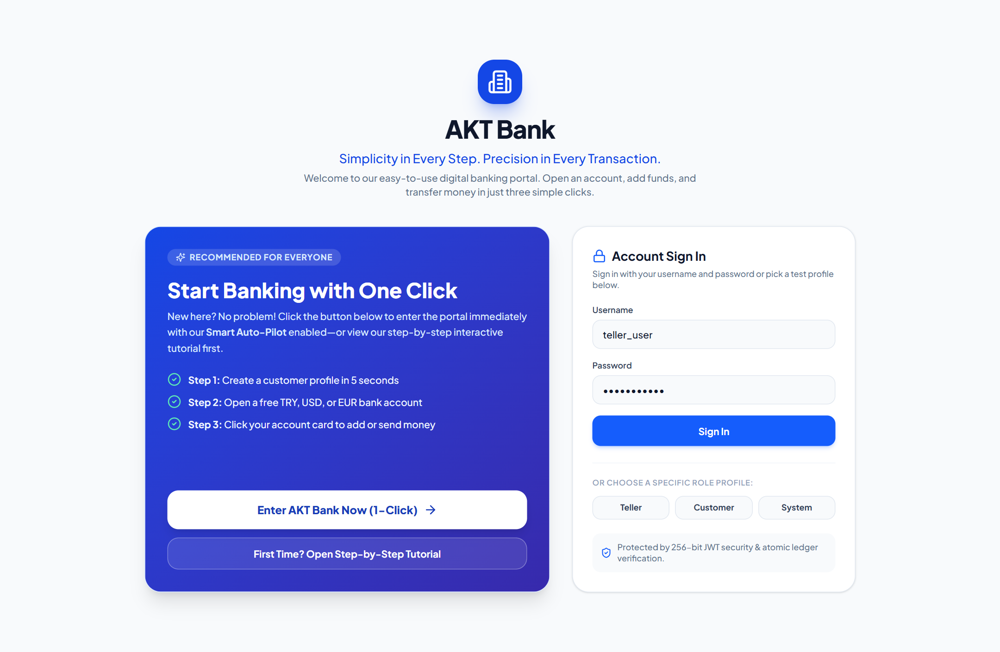
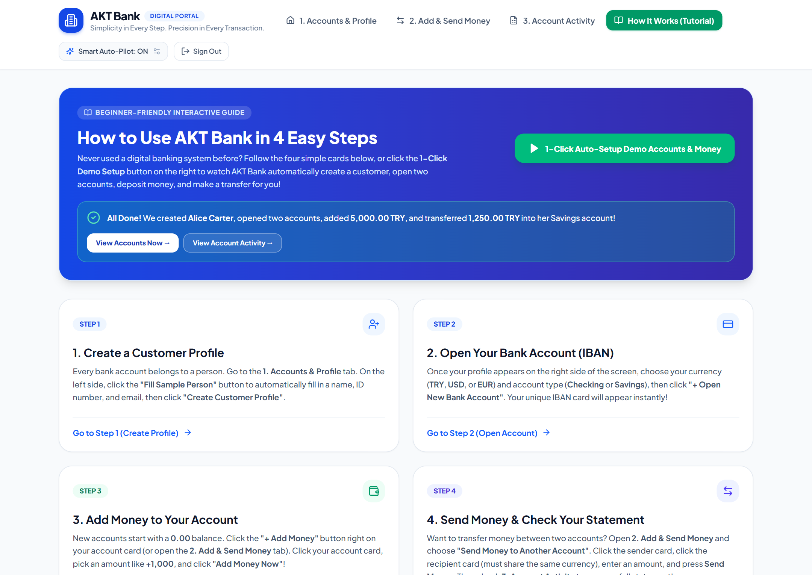
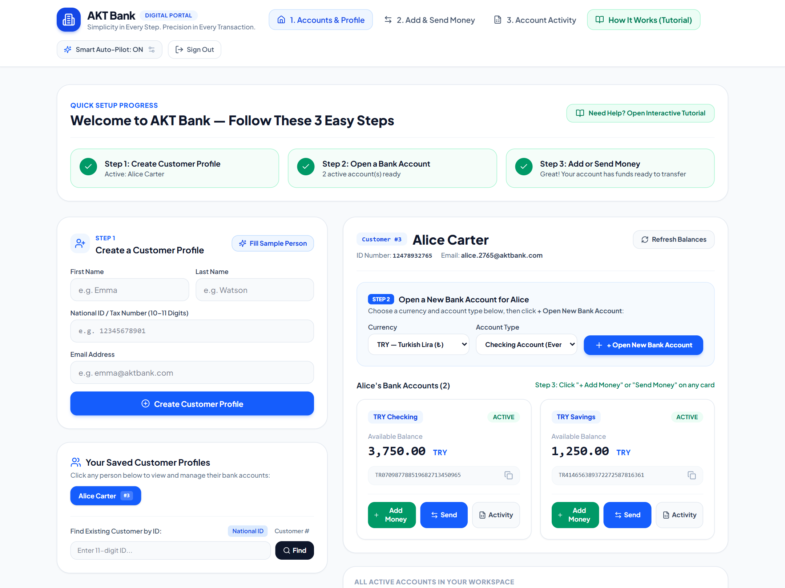
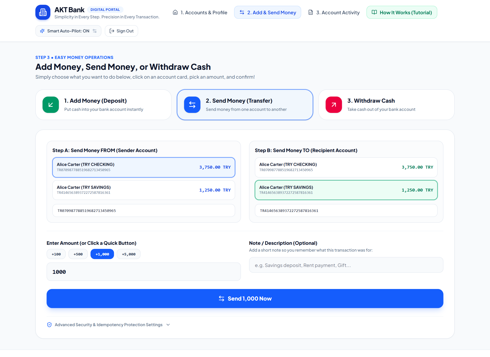
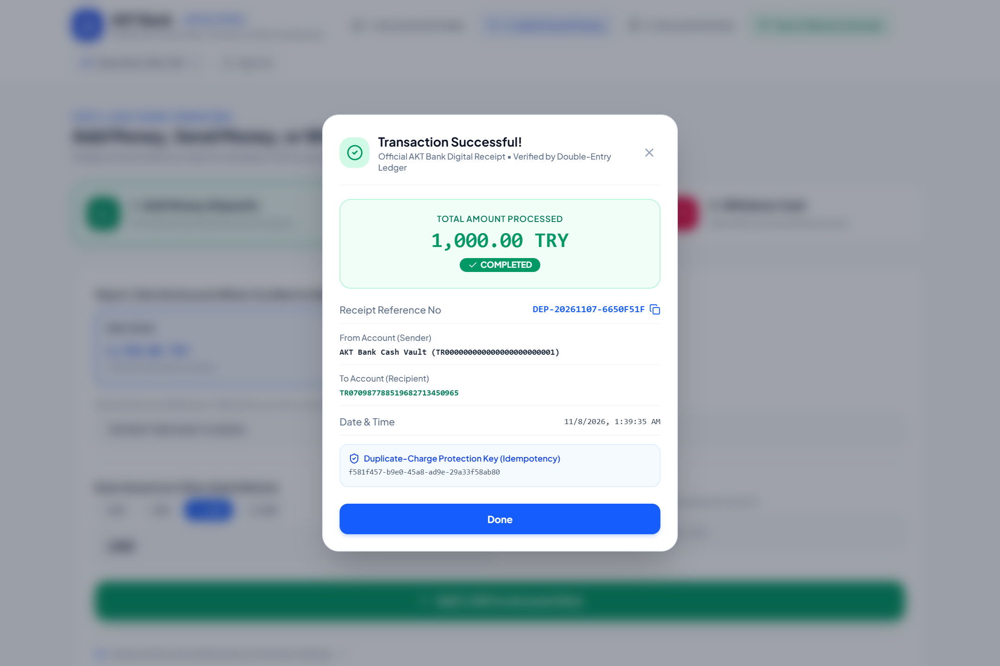
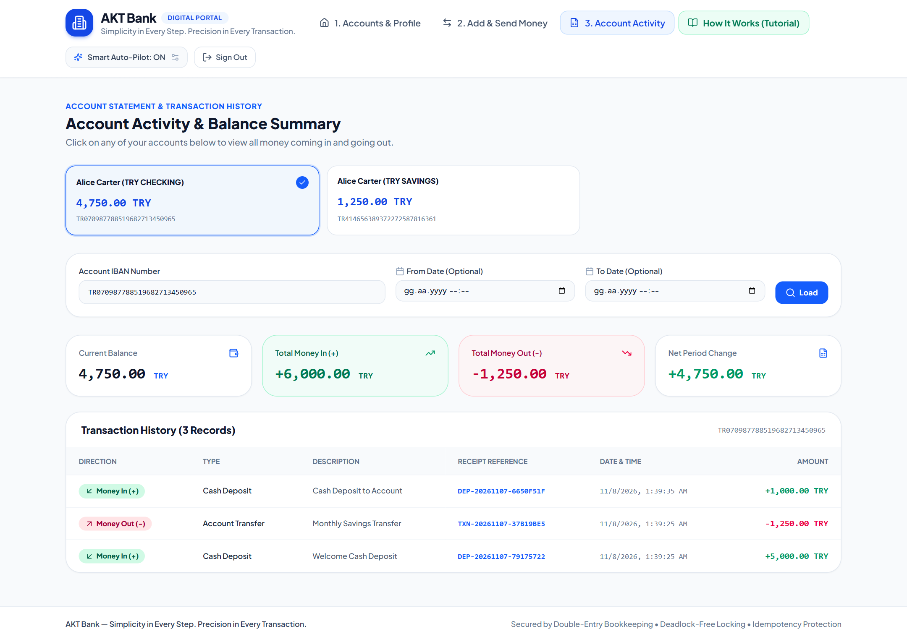

# 🏦 AKT Bank — Enterprise Full-Stack Core Banking Platform

> *"Simplicity in Every Step. Precision in Every Transaction."*

[](https://www.oracle.com/java/)
[](https://spring.io/projects/spring-boot)
[](https://react.dev/)
[](https://www.typescriptlang.org/)
[](https://tailwindcss.com/)
[](https://www.postgresql.org/)
[](https://www.docker.com/)
[](https://en.wikipedia.org/wiki/Double-entry_bookkeeping)

---

## 📌 Project Overview

**`AKT Bank`** is an enterprise-grade full-stack core banking platform engineered to combine high-integrity financial ledger operations with an effortless, beginner-friendly digital banking web experience designed with **Google Stitch**.

The repository is structured as a containerized full-stack monorepo:
* **`backend/`**: High-throughput Core Banking Ledger engine built with **Spring Boot 4**, **Java 21 LTS**, and **PostgreSQL 16**. Enforces **Double-Entry Bookkeeping** ($\sum \text{DEBIT} = \sum \text{CREDIT}$), **Pessimistic Locking with deterministic lexicographical ordering** (eliminating deadlocks), client-side **Idempotency Keys**, JWT Role-Based Access Control (`CUSTOMER`, `TELLER`, `SYSTEM`), and full observability (**Prometheus & Grafana**).
* **`frontend/`**: Clean, bright, beginner-friendly digital banking portal built with **React 19**, **TypeScript**, **Vite**, **Tailwind CSS**, and **Google Stitch (`Clarity Banking System`)**. Features a 3-step visual onboarding guide, clickable visual account selector cards (no manual IBAN typing required), Smart Role Auto-Pilot, and an interactive **How It Works (Tutorial)** tab with 1-click demo data setup.

---

## 🖥️ Web Portal Interface & Screenshots

### 1. Sign-In & 1-Click Quick Start Portal
Clean, welcoming entry screen featuring **1-Click Quick Start**, interactive tutorial access, and role profile selectors.



---

### 2. Interactive "How It Works" Tutorial & 1-Click Demo Setup
Designed so even first-time computer users can master the platform in seconds. Includes a **1-Click Auto-Setup Demo Accounts & Money** button that automatically creates a customer profile, opens Checking & Savings accounts, deposits initial cash, and executes an inter-account transfer.



---

### 3. Guided Customer & Account Dashboard (`1. Accounts & Profile`)
Features a real-time **3-Step Setup Progress Bar**, a **Fill Sample Person** helper, instant multi-currency (`TRY`, `USD`, `EUR`) IBAN account creation, and visual account cards with 1-click actions.



---

### 4. Visual Add & Send Money Center (`2. Add & Send Money`)
Users never need to memorize or copy-paste 26-character IBAN strings—simply click the sender and recipient account cards, choose a quick amount button (`+100`, `+500`, `+1,000`, `+5,000`), and confirm.



---

### 5. Verified Digital Transaction Receipt (Double-Entry & Idempotency Protected)
Every deposit, withdrawal, and transfer returns an instant digital receipt showing the reference number, sender/recipient IBANs, timestamp, and the `Idempotency-Key` UUID barrier.



---

### 6. Account Activity & Ledger Statement (`3. Account Activity`)
Displays **Current Balance**, **Total Money In (+)**, **Total Money Out (-)**, **Net Period Change**, and the immutable append-only transaction history.



---

## 📁 Repository Structure

```text
AKT-Bank/
├── .github/
│   └── workflows/
│       └── ci.yml               # GitHub Actions CI for build & test
├── backend/                     # Core Banking Ledger Engine (Java 21 / Spring Boot 4)
│   ├── docker/                  # Prometheus and Grafana provisioning
│   ├── docs/                    # Backend architectural diagrams & screenshots
│   ├── src/                     # Application source code & integration tests
│   ├── docker-compose.yml       # Containerized environment
│   ├── Dockerfile               # Multi-stage Maven + JRE 21 container build
│   ├── pom.xml                  # Maven dependencies & build lifecycle
│   ├── DATABASE_SCHEMA.md       # Relational database schema & ER diagrams
│   └── README.md                # Detailed backend engine documentation
├── frontend/                    # AKT Bank Digital Portal (React 19 / TypeScript / Tailwind)
│   ├── src/
│   │   ├── api/                 # Axios client, Smart Role Auto-Pilot & API services
│   │   ├── components/          # Layout, ReceiptModal, ErrorAlert
│   │   ├── context/             # JWT AuthContext & Workspace Account state
│   │   ├── pages/               # LoginPage, DashboardPage, TransferPage, StatementPage, TutorialPage
│   │   └── types/               # TypeScript DTO & Enum definitions
│   ├── DESIGN.md                # Google Stitch Clarity Banking Design System
│   ├── FRONTEND_PLAN.md         # Frontend architectural & UX plan
│   ├── Dockerfile               # Multi-stage Node 22 + Nginx 1.27 container build
│   ├── nginx.conf               # Reverse proxy (/api -> backend:8080) & SPA routing
│   └── vite.config.ts           # Vite config (Port 4200)
├── docs/
│   └── screenshots/             # Full-stack UI screenshots
├── docker-compose.yml           # Unified full-stack Docker Compose orchestration
└── README.md                    # Project root documentation
```

---

## 🚀 Getting Started (Full-Stack with Docker Compose)

Launch the entire platform (**PostgreSQL 16 + Spring Boot Backend + React/Nginx Frontend + Prometheus + Grafana**) with a single command from the project root:

```bash
docker compose up -d --build
```

### 🌐 Live Service URLs

| Service | Container Name | URL | Description |
| :--- | :--- | :--- | :--- |
| **AKT Bank Web Portal** | `akt_bank_frontend` | [http://localhost:4200](http://localhost:4200) | React 19 + Tailwind CSS Digital Banking UI |
| **Spring Boot API & Swagger** | `akt_bank_backend` | [http://localhost:8080/swagger-ui.html](http://localhost:8080/swagger-ui.html) | Core Banking REST API & OpenAPI Docs |
| **Grafana Dashboards** | `akt_bank_grafana` | [http://localhost:3000](http://localhost:3000) | Observability & Metrics (`admin` / `admin`) |
| **Prometheus** | `akt_bank_prometheus` | [http://localhost:9090](http://localhost:9090) | Time-series metrics scraper |
| **PostgreSQL 16** | `akt_bank_postgres` | `localhost:5432` | Relational Ledger DB (`akt` / `akt`) |

### 💻 Running Frontend Locally for Development

```bash
cd frontend
npm install
npm run dev
```

---

## 🔒 Security & Architectural Guarantees
* **Double-Entry Bookkeeping:** Append-only ledger where every transaction posts balanced `DEBIT` and `CREDIT` entries ($\sum \text{DEBIT} = \sum \text{CREDIT}$).
* **Deadlock Elimination:** Deterministic lexicographical locking order applied on account IBANs.
* **Idempotency Barrier:** Guarantees safe network retries without duplicate charges via `Idempotency-Key` headers.
* **Banker's Precision:** Enforces `NUMERIC(19, 4)` and `CHECK (balance >= 0)` constraints at the database level.

For deep-dive backend documentation and ER diagrams, see 👉 **[Backend Documentation](./backend/README.md)** and **[Database Schema](./backend/DATABASE_SCHEMA.md)**.
